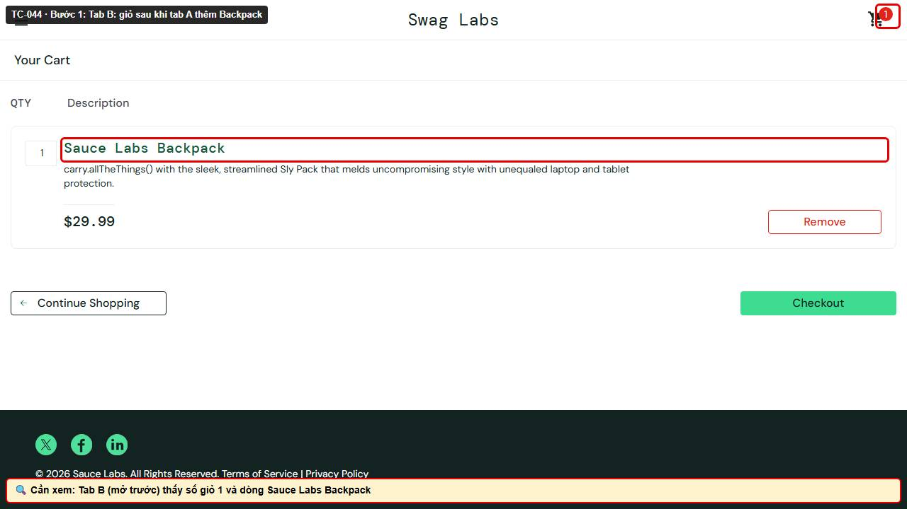
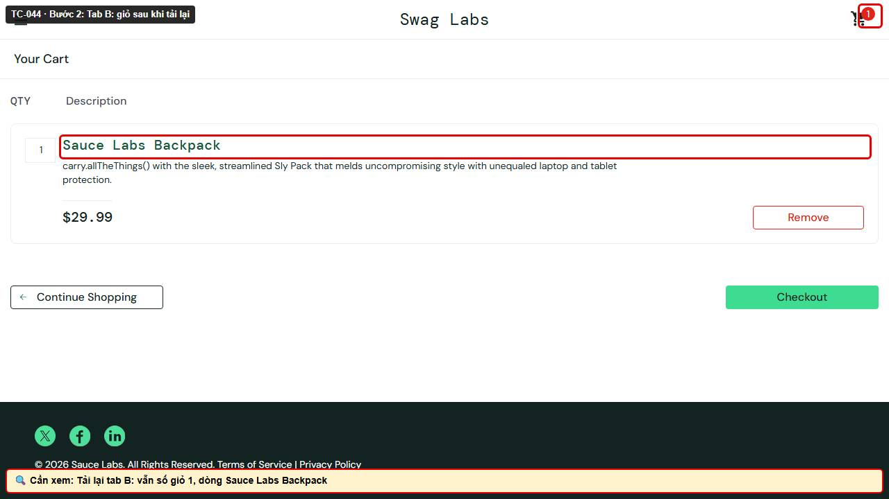
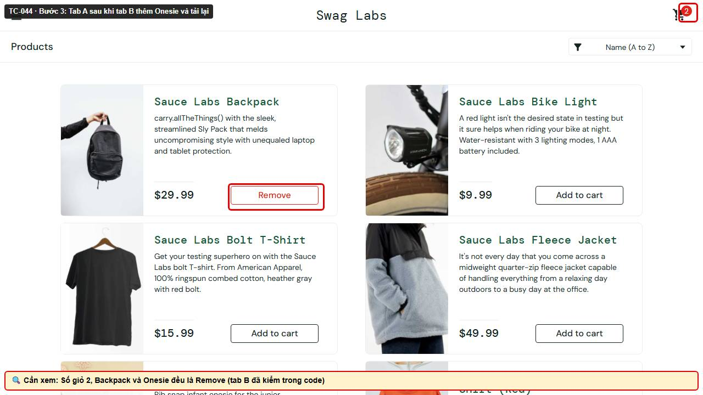

# TC-044 hai tab: thay đổi giỏ ở tab này, tab kia thấy đúng

- **Kết quả**: ✅ Passed
- **Nhóm**: Chung: nhiều màn hình (tài khoản, giỏ, menu, kiểm soát truy cập)
- **Tags**: @AC-7 @list @cart
- **Thời điểm**: 2026-11-26T09:33:59.980Z
- **Video**: [video.webm](video.webm) (quay ở lần chạy ngày 2026-11-25, lần này không quay lại: EVIDENCE_KEEP_VIDEOS)

| Bước | Thao tác | Cần xem | Ảnh |
|---|---|---|---|
| 1 | Tab B: giỏ sau khi tab A thêm Backpack | Tab B (mở trước) thấy số giỏ 1 và dòng Sauce Labs Backpack |  |
| 2 | Tab B: giỏ sau khi tải lại | Tải lại tab B: vẫn số giỏ 1, dòng Sauce Labs Backpack |  |
| 3 | Tab A sau khi tab B thêm Onesie và tải lại | Số giỏ 2, Backpack và Onesie đều là Remove (tab B đã kiểm trong code) |  |
