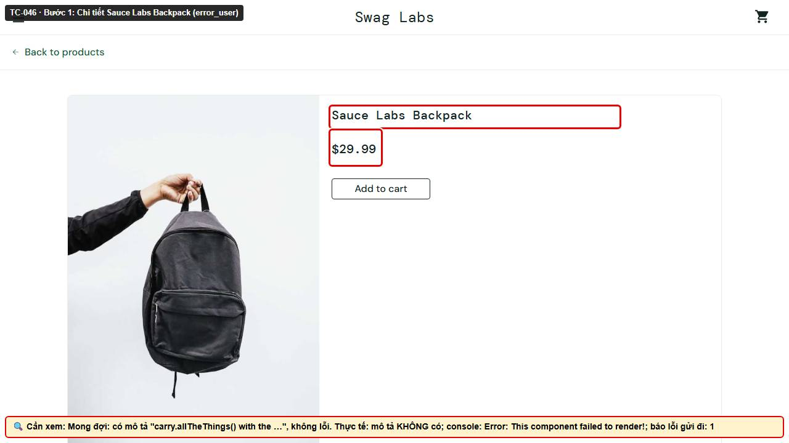
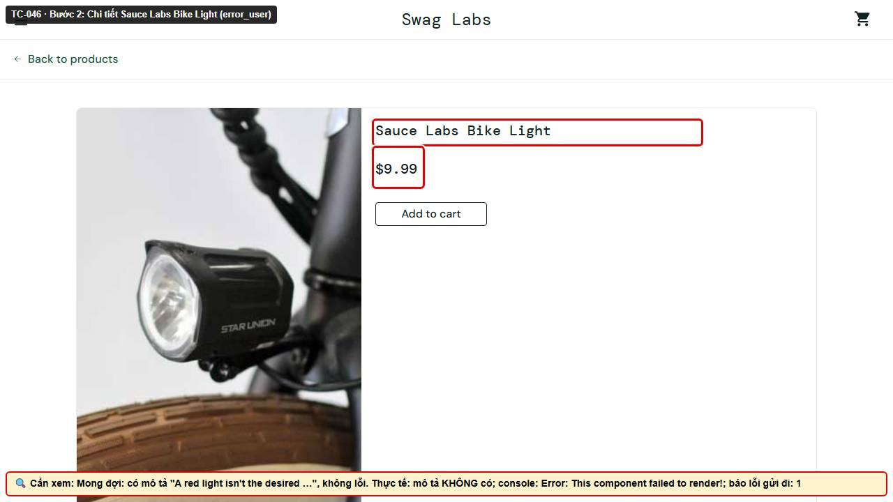
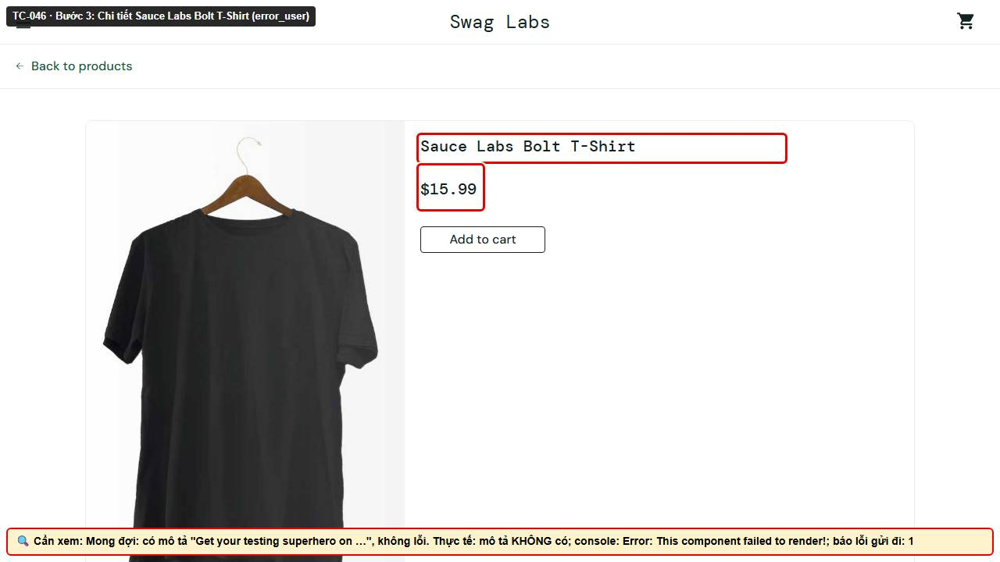
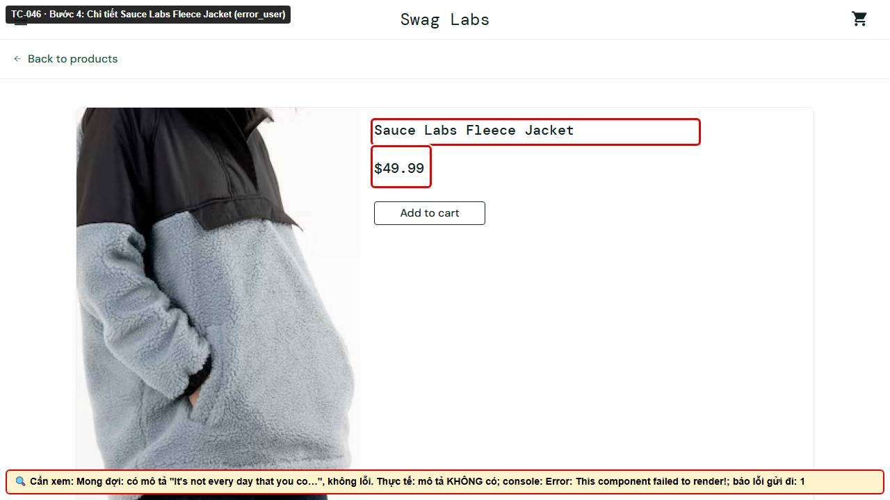
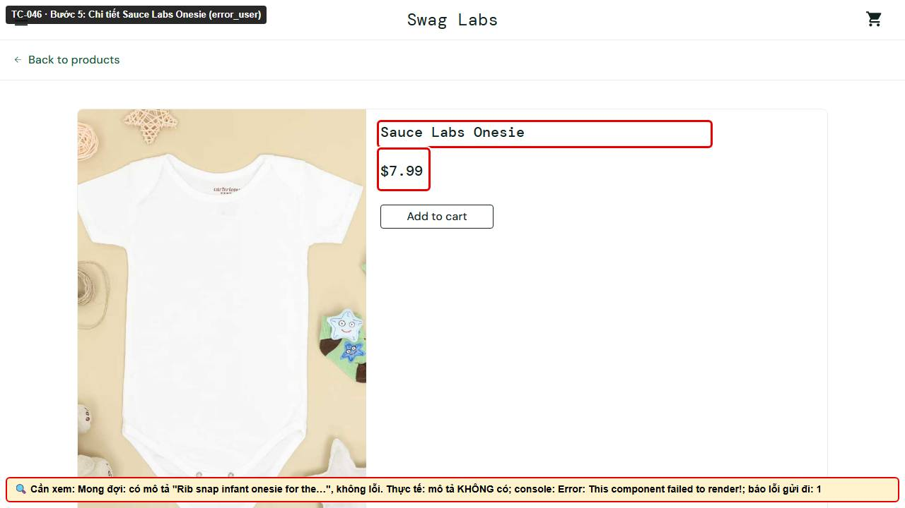
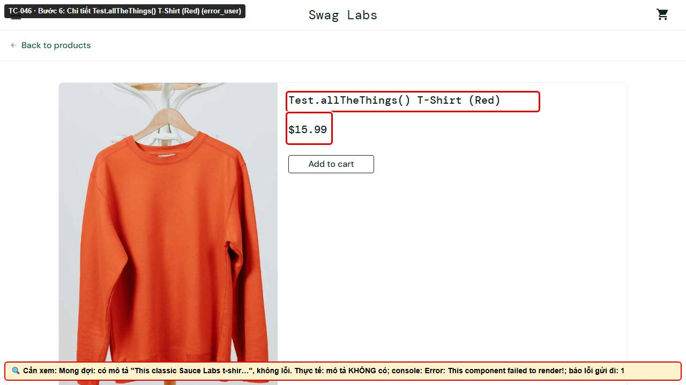

# TC-046 error_user: trang chi tiết hiển thị đủ thông tin, không có lỗi JavaScript hay báo lỗi

- **Kết quả**: ❌ Failed · Bug: BUG-21
- **Nhóm**: Màn hình 2: Chi tiết sản phẩm (/inventory-item.html?id=<n>)
- **Tags**: @AC-5 @detail @BUG-21
- **Thời điểm**: 2026-11-25T08:13:04.475Z
- **Video**: [video.webm](video.webm)

| Bước | Thao tác | Cần xem | Ảnh |
|---|---|---|---|
| 1 | Chi tiết Sauce Labs Backpack (error_user) | Mong đợi: có mô tả "carry.allTheThings() with the …", không lỗi. Thực tế: mô tả KHÔNG có; console: Error: This component failed to render!; báo lỗi gửi đi: 1 |  |
| 2 | Chi tiết Sauce Labs Bike Light (error_user) | Mong đợi: có mô tả "A red light isn't the desired …", không lỗi. Thực tế: mô tả KHÔNG có; console: Error: This component failed to render!; báo lỗi gửi đi: 1 |  |
| 3 | Chi tiết Sauce Labs Bolt T-Shirt (error_user) | Mong đợi: có mô tả "Get your testing superhero on …", không lỗi. Thực tế: mô tả KHÔNG có; console: Error: This component failed to render!; báo lỗi gửi đi: 1 |  |
| 4 | Chi tiết Sauce Labs Fleece Jacket (error_user) | Mong đợi: có mô tả "It's not every day that you co…", không lỗi. Thực tế: mô tả KHÔNG có; console: Error: This component failed to render!; báo lỗi gửi đi: 1 |  |
| 5 | Chi tiết Sauce Labs Onesie (error_user) | Mong đợi: có mô tả "Rib snap infant onesie for the…", không lỗi. Thực tế: mô tả KHÔNG có; console: Error: This component failed to render!; báo lỗi gửi đi: 1 |  |
| 6 | Chi tiết Test.allTheThings() T-Shirt (Red) (error_user) | Mong đợi: có mô tả "This classic Sauce Labs t-shir…", không lỗi. Thực tế: mô tả KHÔNG có; console: Error: This component failed to render!; báo lỗi gửi đi: 1 |  |
