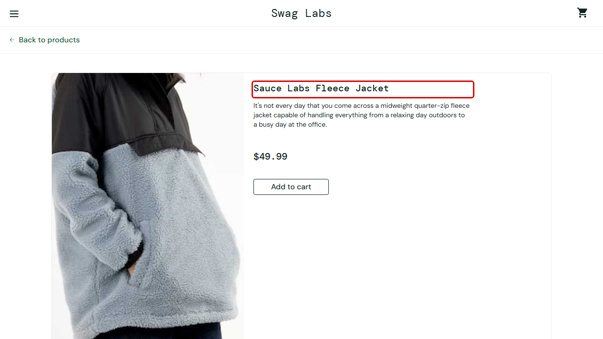
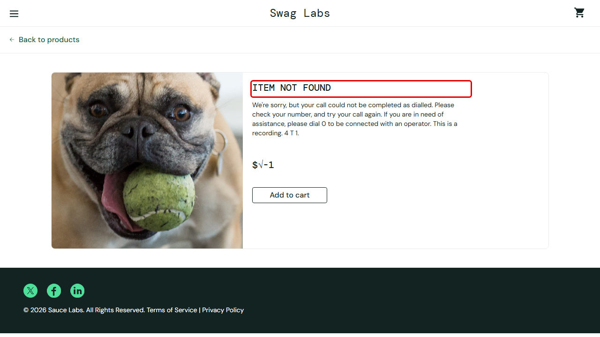
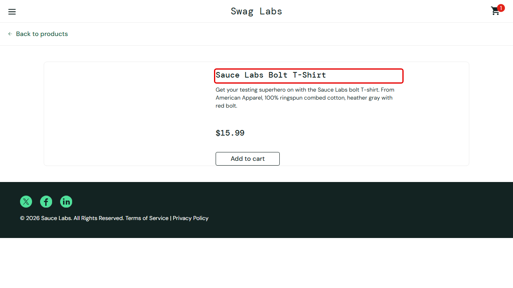

# BUG-11: tái hiện độc lập (2026-11-25)

**`problem_user`: bấm sản phẩm mở trang chi tiết của sản phẩm có id + 1**

Script riêng [`tests/repro/saucedemo-products-cart-screen.repro.ts`](../../../../../../tests/repro/saucedemo-products-cart-screen.repro.ts) (`npm run repro -- saucedemo-products-cart-screen`), **không** dùng code test: locator id / class CSS, mỗi tình huống một phiên trình duyệt mới (giỏ trống), Chromium 1280×720. Mỗi tình huống chạy 2 lần: **2/2 lần, kết quả giống nhau**. Ảnh của lần 2, khung đỏ do script vẽ để chỉ chỗ lỗi. Các bước làm bằng tay nằm trong `defects.md`.

| # | Thao tác | Kết quả thấy được | Ảnh |
|---|---|---|---|
| 1 | Danh sách: bấm **tên** Sauce Labs Backpack (id 4) | Mở `?id=5`: `Sauce Labs Fleece Jacket` |  |
| 2 | Danh sách: bấm **ảnh** Fleece Jacket (id 5) | Mở `?id=6`: `ITEM NOT FOUND` |  |
| 3 | Giỏ chỉ có Bike Light (id 0): bấm **tên** trong giỏ | Mở `?id=1`: `Sauce Labs Bolt T-Shirt` |  |

Kết luận: mỗi lần bấm mở sản phẩm có id lớn hơn **đúng 1 đơn vị** (id + 1); Fleece Jacket (id 5) mở id 6 không tồn tại. Xảy ra ở danh sách (tên, ảnh) và trang giỏ.
