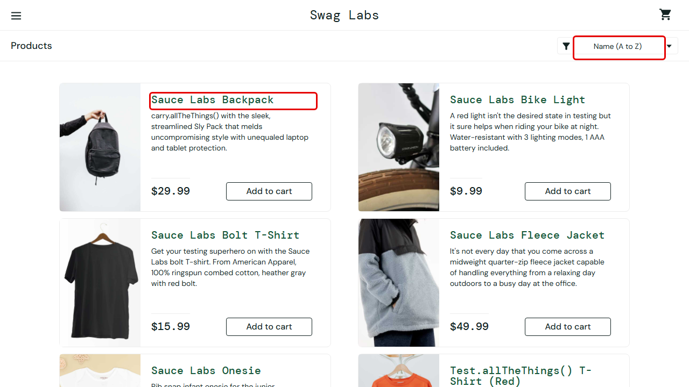

# BUG-12: tái hiện độc lập (2026-11-25)

**`error_user`: sắp xếp báo lỗi, danh sách không đổi**

Script riêng [`tests/repro/saucedemo-products-cart-screen.repro.ts`](../../../../../../tests/repro/saucedemo-products-cart-screen.repro.ts) (`npm run repro -- saucedemo-products-cart-screen`), **không** dùng code test: locator id / class CSS, mỗi tình huống một phiên trình duyệt mới (giỏ trống), Chromium 1280×720. Mỗi tình huống chạy 2 lần: **2/2 lần, kết quả giống nhau**. Ảnh của lần 2, khung đỏ do script vẽ để chỉ chỗ lỗi. Các bước làm bằng tay nằm trong `defects.md`.

| # | Thao tác | Kết quả thấy được | Ảnh |
|---|---|---|---|
| 1 | Đăng nhập `error_user`, chọn **Name (Z to A)** | Nhãn dropdown `Name (A to Z)`; đứng đầu `Sauce Labs Backpack`; hộp thoại: `Sorting is broken! This error has been reported to Backtrace.` |  |
| 2 | Đăng nhập `error_user`, chọn **Price (low to high)** | Nhãn dropdown `Name (A to Z)`; đứng đầu `Sauce Labs Backpack`; hộp thoại: `Sorting is broken! This error has been reported to Backtrace.` |  |
| 3 | Đăng nhập `error_user`, chọn **Price (high to low)** | Nhãn dropdown `Name (A to Z)`; đứng đầu `Sauce Labs Backpack`; hộp thoại: `Sorting is broken! This error has been reported to Backtrace.` |  |

Kết luận: cả 3 kiểu: hiện hộp thoại lỗi của trình duyệt (MSG-01), nhãn và thứ tự không đổi. Ảnh không thấy hộp thoại (hộp thoại của trình duyệt), nội dung ghi ở cột kết quả.
