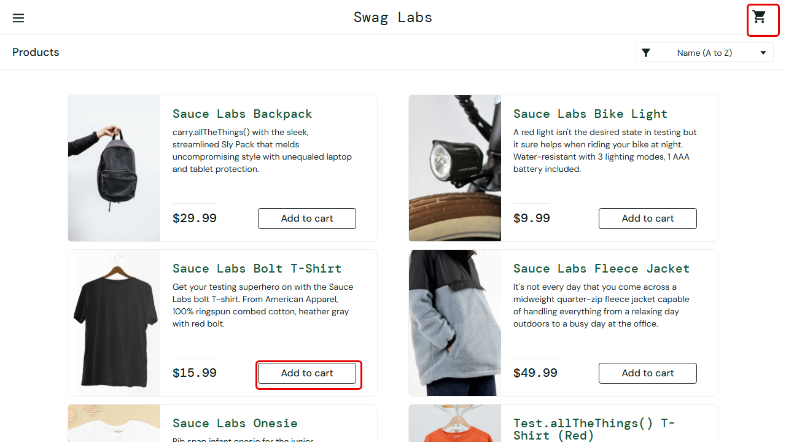
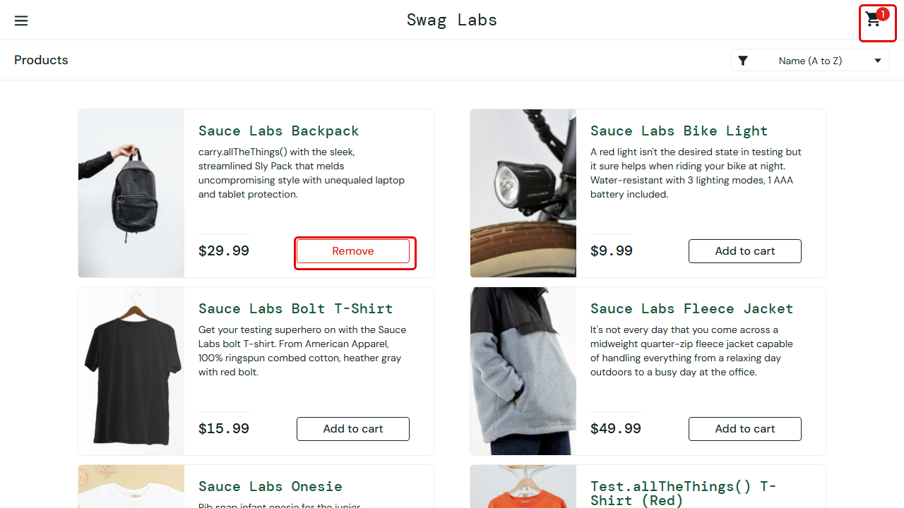
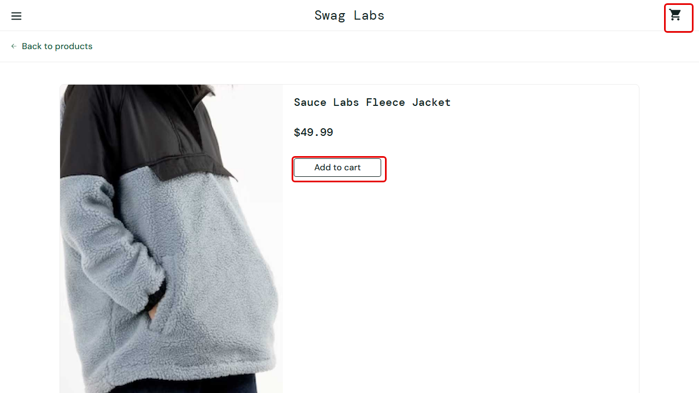

# BUG-13: tái hiện độc lập (2026-11-25)

**`error_user`: Add / Remove không có tác dụng với 3 + 3 sản phẩm**

Script riêng [`tests/repro/saucedemo-products-cart-screen.repro.ts`](../../../../../../tests/repro/saucedemo-products-cart-screen.repro.ts) (`npm run repro -- saucedemo-products-cart-screen`), **không** dùng code test: locator id / class CSS, mỗi tình huống một phiên trình duyệt mới (giỏ trống), Chromium 1280×720. Mỗi tình huống chạy 2 lần: **2/2 lần, kết quả giống nhau**. Ảnh của lần 2, khung đỏ do script vẽ để chỉ chỗ lỗi. Các bước làm bằng tay nằm trong `defects.md`.

| # | Thao tác | Kết quả thấy được | Ảnh |
|---|---|---|---|
| 1 | Danh sách: bấm Add to cart ở Bolt T-Shirt | Nút: `Add to cart`; số giỏ: (không có); lỗi JavaScript: `Failed to add item to the cart.` |  |
| 2 | Giỏ có sẵn Backpack; danh sách: bấm Remove ở Backpack | Nút: `Remove`; số giỏ: 1; lỗi JavaScript: `Failed to remove item from cart.` |  |
| 3 | Chi tiết Fleece Jacket (`?id=5`): bấm Add to cart | Nút: `Add to cart`; số giỏ: (không có); lỗi JavaScript: `Failed to add item to the cart.` |  |
| 4 | Đối chứng: giỏ có Backpack, bấm Remove **ở trang giỏ** | Giỏ còn 0 dòng; số giỏ: (không có) (đúng) |  |

Kết luận: Add không ăn với Bolt T-Shirt, Fleece Jacket, Red T-Shirt; Remove không ăn với Backpack, Bike Light, Onesie, ở danh sách và chi tiết (thử đại diện; đủ 24 điểm ở test tự động). Bỏ ở trang giỏ thì được. Mỗi lần không ăn, trang ném lỗi JavaScript (MSG-05 / MSG-06).
