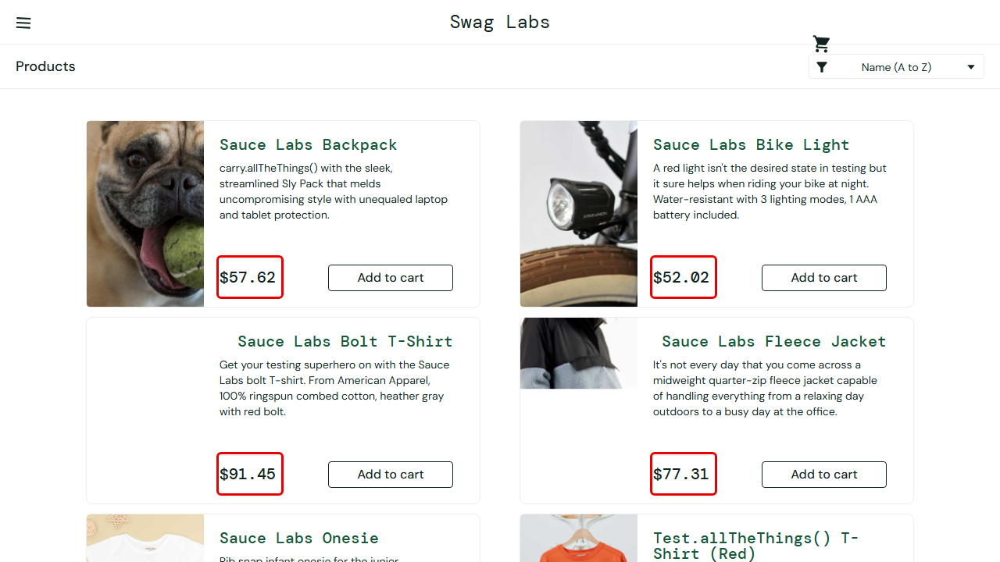
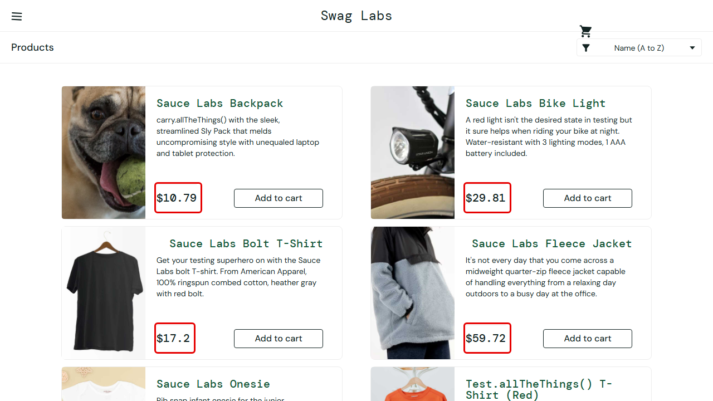
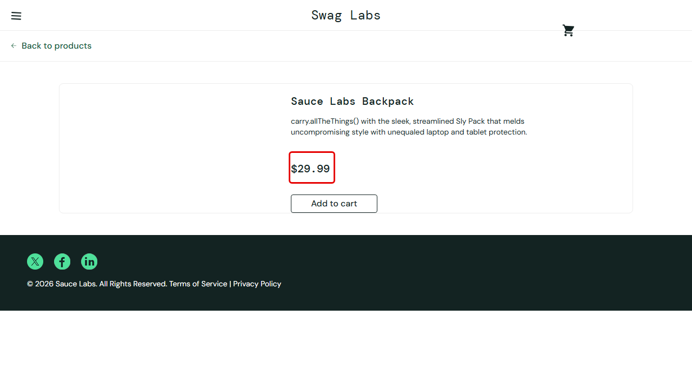
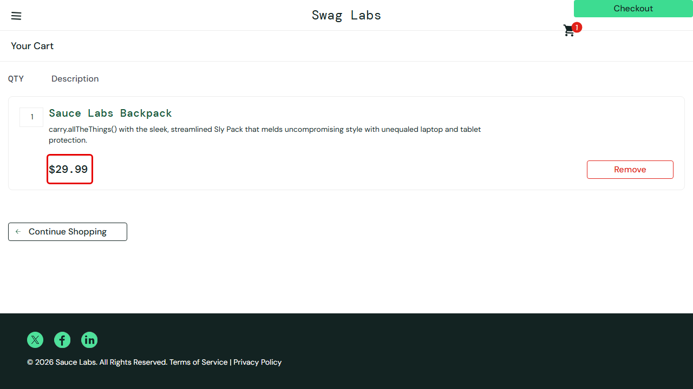

# BUG-14: tái hiện độc lập (2026-11-25)

**`visual_user`: giá ở danh sách sai và đổi mỗi lần tải**

Script riêng [`tests/repro/saucedemo-products-cart-screen.repro.ts`](../../../../../../tests/repro/saucedemo-products-cart-screen.repro.ts) (`npm run repro -- saucedemo-products-cart-screen`), **không** dùng code test: locator id / class CSS, mỗi tình huống một phiên trình duyệt mới (giỏ trống), Chromium 1280×720. Mỗi tình huống chạy 2 lần: **2/2 lần đều có lỗi** (giá trị đổi giữa 2 lần, đúng bản chất bug). Ảnh của lần 2, khung đỏ do script vẽ để chỉ chỗ lỗi. Các bước làm bằng tay nằm trong `defects.md`.

| # | Thao tác | Kết quả thấy được | Ảnh |
|---|---|---|---|
| 1 | Đăng nhập `visual_user`, xem giá | Giá: $57.62, $52.02, $91.45, $77.31, $77.75, $86.99 (đúng: $29.99, $9.99, $15.99, $49.99, $7.99, $15.99) |  |
| 2 | Tải lại trang (F5) | Giá: $10.79, $29.81, $17.2, $59.72, $71.73, $87.67 (đúng: $29.99, $9.99, $15.99, $49.99, $7.99, $15.99) |  |
| 3 | Bấm tên Backpack mở chi tiết | Giá ở chi tiết: `$29.99` |  |
| 4 | Bấm Add to cart, mở giỏ | Giá ở giỏ: `$29.99` |  |

Lần 1:

1. Giá: $60.09, $94.3, $68.86, $0.22, $46.32, $0.07 (đúng: $29.99, $9.99, $15.99, $49.99, $7.99, $15.99)
2. Giá: $82.1, $74.92, $76.04, $94.13, $56.15, $41.39 (đúng: $29.99, $9.99, $15.99, $49.99, $7.99, $15.99)
3. Giá ở chi tiết: `$29.99`
4. Giá ở giỏ: `$29.99`

Kết luận: giá ở danh sách sai và khác nhau giữa 2 lần tải; giá ở trang chi tiết và giỏ đúng.
