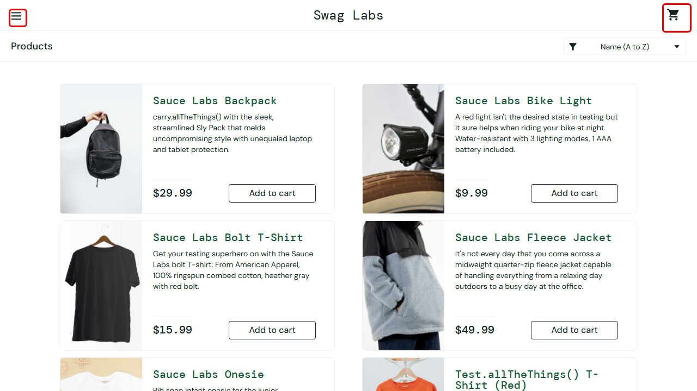
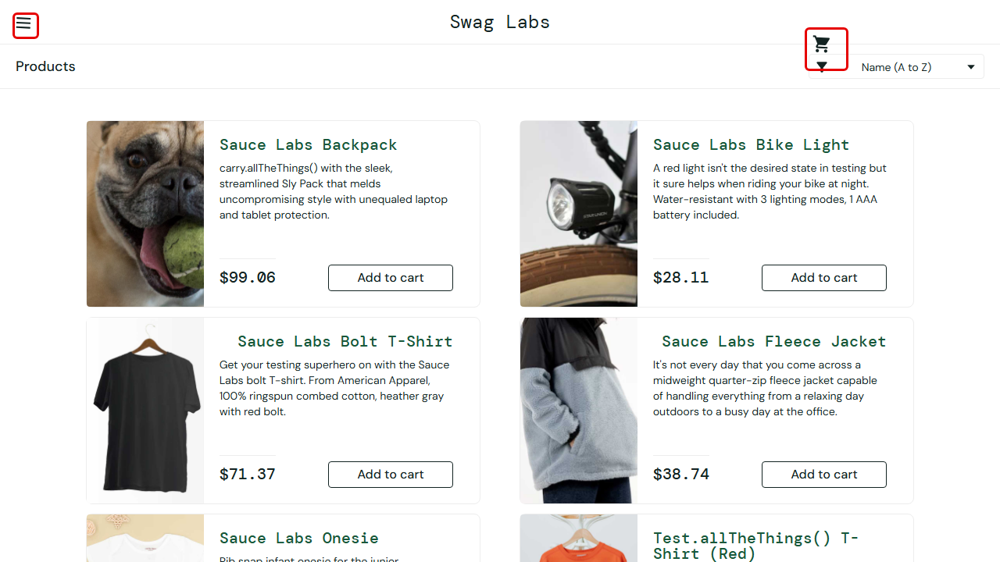

# BUG-16: tái hiện độc lập (2026-11-25)

**`visual_user`: biểu tượng giỏ, menu lệch và bị xoay**

Script riêng [`tests/repro/saucedemo-products-cart-screen.repro.ts`](../../../../../../tests/repro/saucedemo-products-cart-screen.repro.ts) (`npm run repro -- saucedemo-products-cart-screen`), **không** dùng code test: locator id / class CSS, mỗi tình huống một phiên trình duyệt mới (giỏ trống), Chromium 1280×720. Mỗi tình huống chạy 2 lần: **2/2 lần, kết quả giống nhau**. Ảnh của lần 2, khung đỏ do script vẽ để chỉ chỗ lỗi. Các bước làm bằng tay nằm trong `defects.md`.

| # | Thao tác | Kết quả thấy được | Ảnh |
|---|---|---|---|
| 1 | `standard_user`: danh sách, đo biểu tượng giỏ (DevTools Console: `document.querySelector('.shopping_cart_container').getBoundingClientRect()`, `getComputedStyle(…).transform`) | x=1220, y=10, transform `none` |  |
| 2 | `visual_user`: danh sách, đo biểu tượng giỏ (DevTools Console: `document.querySelector('.shopping_cart_container').getBoundingClientRect()`, `getComputedStyle(…).transform`) | x=1034, y=39, transform `matrix(0.99863, 0.052336, -0.052336, 0.99863, 0, 0)` |  |

Kết luận: biểu tượng giỏ của `visual_user` lệch vị trí và bị xoay (transform khác `none`). Test tự động đo thêm biểu tượng menu, nút Add, ở cả 3 trang.
