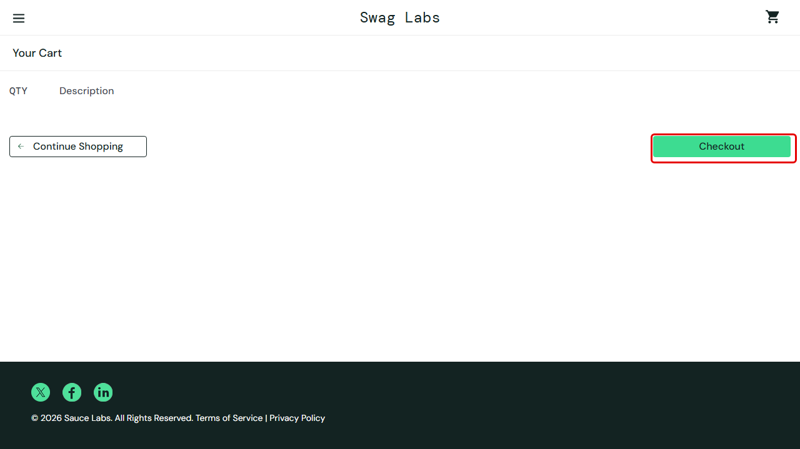
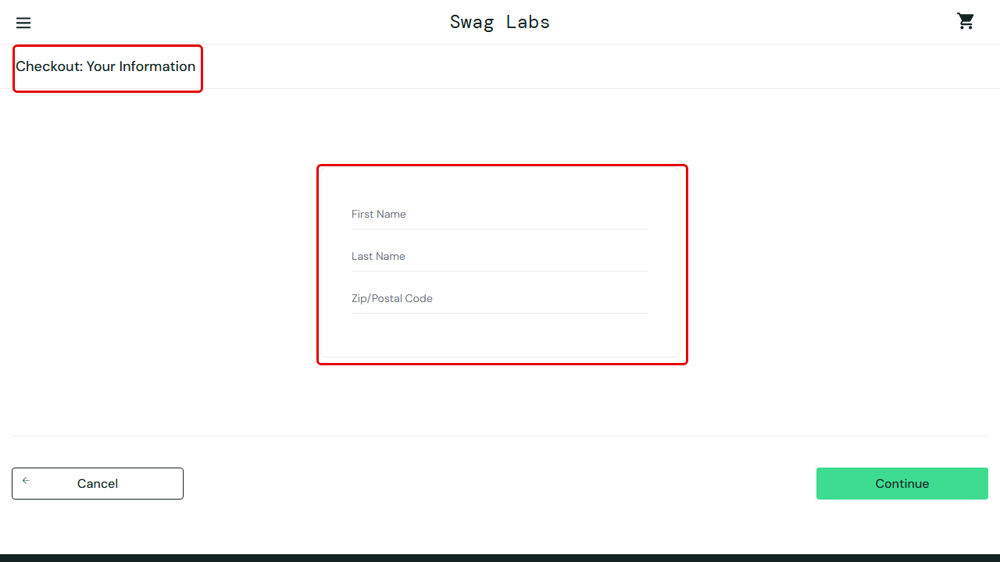

# BUG-19: tái hiện độc lập (2026-11-25)

**Giỏ trống vẫn sang được bước thanh toán**

Script riêng [`tests/repro/saucedemo-products-cart-screen.repro.ts`](../../../../../../tests/repro/saucedemo-products-cart-screen.repro.ts) (`npm run repro -- saucedemo-products-cart-screen`), **không** dùng code test: locator id / class CSS, mỗi tình huống một phiên trình duyệt mới (giỏ trống), Chromium 1280×720. Mỗi tình huống chạy 2 lần: **2/2 lần, kết quả giống nhau**. Ảnh của lần 2, khung đỏ do script vẽ để chỉ chỗ lỗi. Các bước làm bằng tay nằm trong `defects.md`.

| # | Thao tác | Kết quả thấy được | Ảnh |
|---|---|---|---|
| 1 | Giỏ trống, mở giỏ | 0 dòng; nút Checkout bấm được |  |
| 2 | Bấm Checkout | Sang `/checkout-step-one.html`, tiêu đề `Checkout: Your Information` |  |

Kết luận: giỏ trống vẫn bấm Checkout và sang bước nhập thông tin thanh toán.
