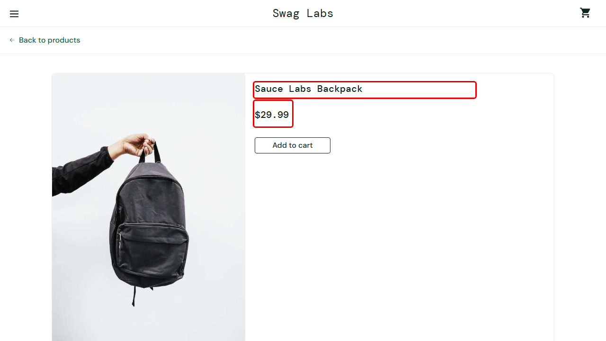
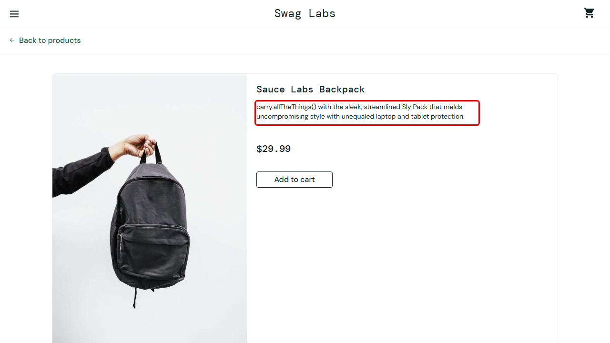

# BUG-21: tái hiện độc lập (2026-11-25)

**`error_user`: trang chi tiết mất mô tả sản phẩm, console báo lỗi render, trang gửi báo lỗi ra ngoài**

Script riêng [`tests/repro/saucedemo-products-cart-screen.repro.ts`](../../../../../../tests/repro/saucedemo-products-cart-screen.repro.ts) (`npm run repro -- saucedemo-products-cart-screen`), **không** dùng code test: locator id / class CSS, mỗi tình huống một phiên trình duyệt mới (giỏ trống), Chromium 1280×720. Mỗi tình huống chạy 2 lần: **2/2 lần, kết quả giống nhau**. Ảnh của lần 2, khung đỏ do script vẽ để chỉ chỗ lỗi. Các bước làm bằng tay nằm trong `defects.md`.

| # | Thao tác | Kết quả thấy được | Ảnh |
|---|---|---|---|
| 1 | `error_user`: bấm tên Backpack mở chi tiết, xem trang, tab Console và tab Network (DevTools) | Trang: tên `Sauce Labs Backpack`, **KHÔNG có mô tả**; console: `Error: This component failed to render!`; request báo lỗi: submit.backtrace.io |  |
| 2 | `standard_user`: bấm tên Backpack mở chi tiết, xem trang, tab Console và tab Network (DevTools) | Trang: tên `Sauce Labs Backpack`, có mô tả "carry.allTheThings() with…"; console: không có lỗi; request báo lỗi: không có |  |

Kết luận: `error_user` mở trang chi tiết: **mất phần mô tả sản phẩm** (phần bị lỗi render), console báo `Error: This component failed to render!` và có 1 request báo lỗi tới `submit.backtrace.io`; `standard_user` (đối chứng) có mô tả, không lỗi.
