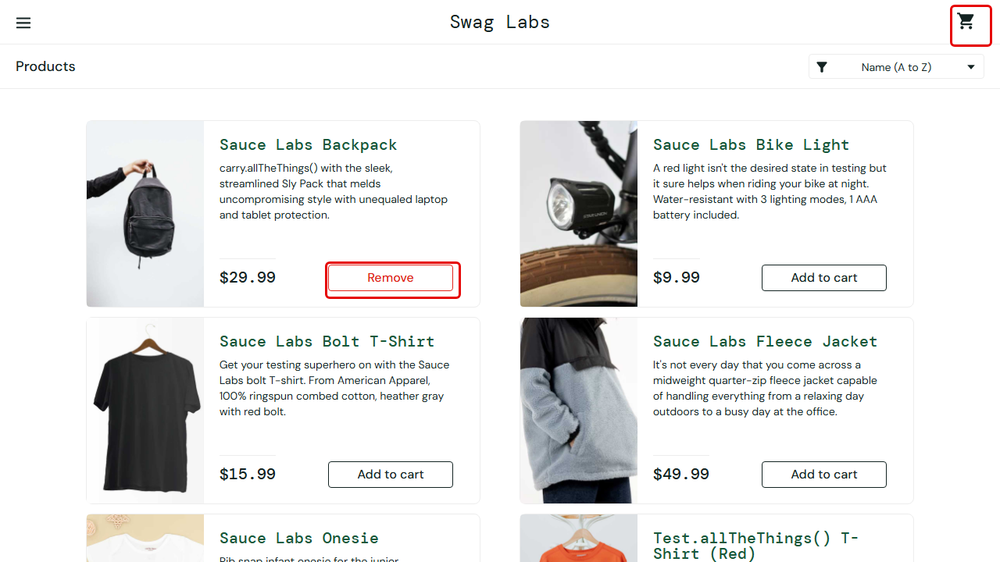
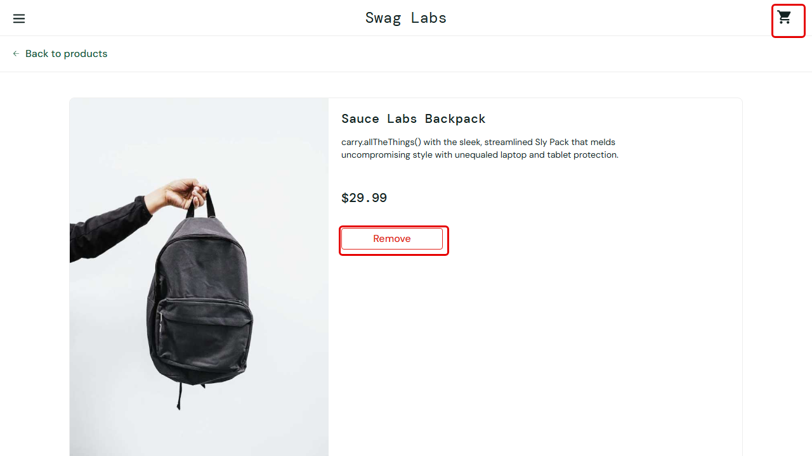
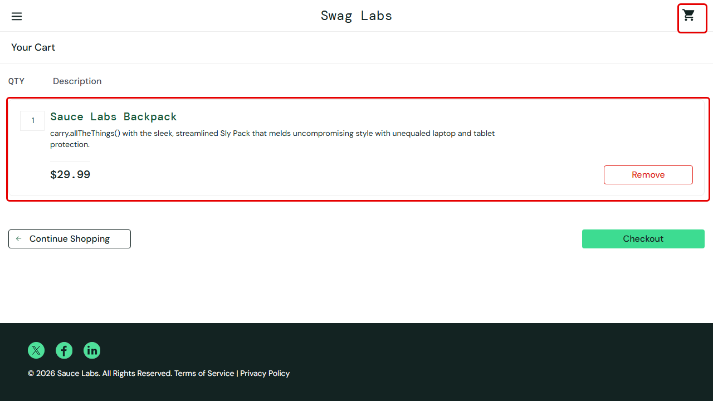

# BUG-05: tái hiện độc lập (2026-11-25)

**Reset App State xóa giỏ nhưng giao diện không cập nhật**

Script riêng [`tests/repro/saucedemo-products-cart-screen.repro.ts`](../../../../../../tests/repro/saucedemo-products-cart-screen.repro.ts) (`npm run repro -- saucedemo-products-cart-screen`), **không** dùng code test: locator id / class CSS, mỗi tình huống một phiên trình duyệt mới (giỏ trống), Chromium 1280×720. Mỗi tình huống chạy 2 lần: **2/2 lần, kết quả giống nhau**. Ảnh của lần 2, khung đỏ do script vẽ để chỉ chỗ lỗi. Các bước làm bằng tay nằm trong `defects.md`.

| # | Thao tác | Kết quả thấy được | Ảnh |
|---|---|---|---|
| 1 | Danh sách: thêm Backpack, menu ☰ → **Reset App State** | Số giỏ: (không có); nút Backpack vẫn là `Remove` |  |
| 2 | Chi tiết Backpack (`?id=4`): bấm Add to cart, Reset App State | Số giỏ: (không có); nút vẫn là `Remove` |  |
| 3 | Danh sách: thêm Backpack, mở giỏ, Reset App State | Số giỏ: (không có); giỏ vẫn hiện 1 dòng |  |
| 4 | Tải lại trang giỏ | Giỏ còn 0 dòng (dữ liệu đã xóa, chỉ giao diện chưa cập nhật) |  |

Kết luận: ở cả 3 trang, số trên giỏ mất nhưng nút / dòng giỏ vẫn như cũ cho tới khi tải lại trang.
