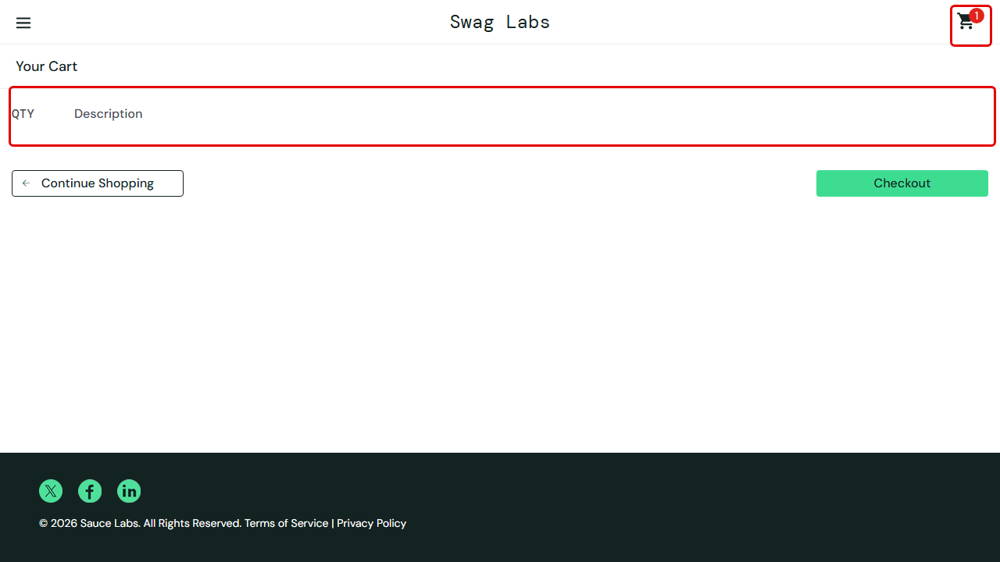
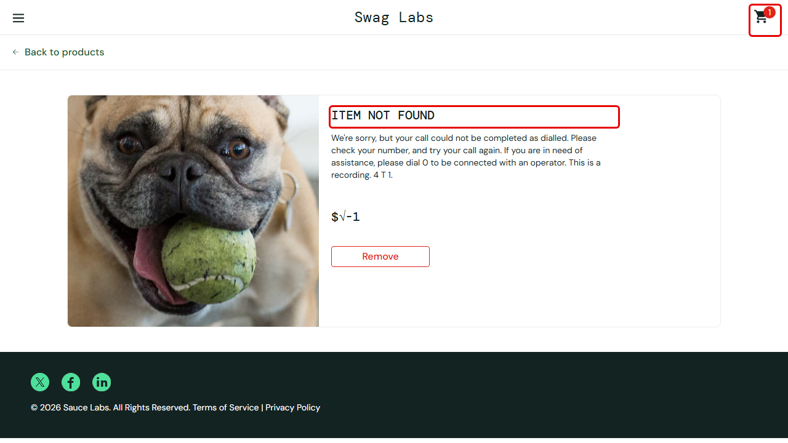
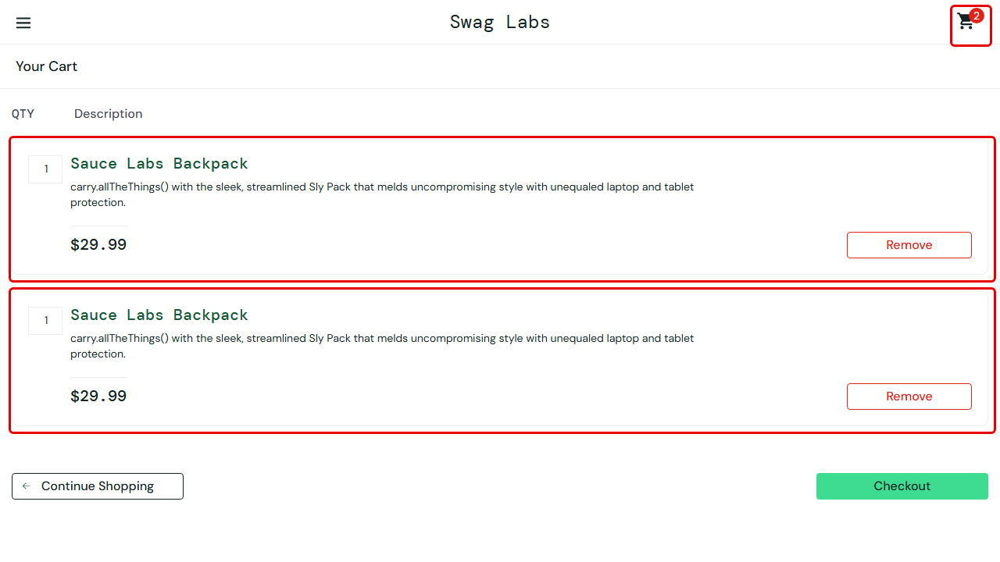
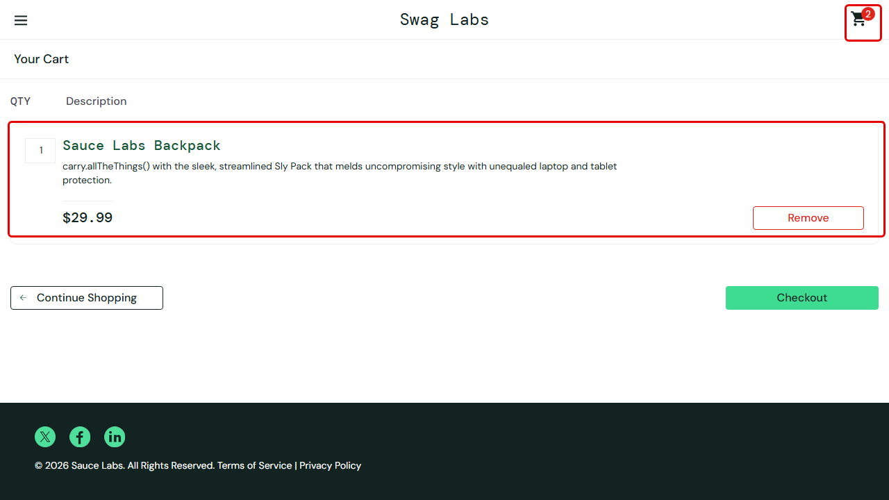

# BUG-06: tái hiện độc lập (2026-11-25)

**Giỏ không kiểm tra dữ liệu: thêm được sản phẩm không tồn tại, hiện dữ liệu trùng, số giỏ sai**

Script riêng [`tests/repro/saucedemo-products-cart-screen.repro.ts`](../../../../../../tests/repro/saucedemo-products-cart-screen.repro.ts) (`npm run repro -- saucedemo-products-cart-screen`), **không** dùng code test: locator id / class CSS, mỗi tình huống một phiên trình duyệt mới (giỏ trống), Chromium 1280×720. Mỗi tình huống chạy 2 lần: **2/2 lần, kết quả giống nhau**. Ảnh của lần 2, khung đỏ do script vẽ để chỉ chỗ lỗi. Các bước làm bằng tay nằm trong `defects.md`.

| # | Thao tác | Kết quả thấy được | Ảnh |
|---|---|---|---|
| 1 | Mở `/inventory-item.html?id=99`, bấm Add to cart (nếu có) | Tên `ITEM NOT FOUND`; CÓ nút Add to cart; sau khi bấm số giỏ: 1 |  |
| 2 | Mở giỏ (sau id=99) | Số giỏ 1 nhưng giỏ có 0 dòng |  |
| 3 | Mở `/inventory-item.html?id=6`, bấm Add to cart (nếu có) | Tên `ITEM NOT FOUND`; CÓ nút Add to cart; sau khi bấm số giỏ: 1 |  |
| 4 | Mở `/inventory-item.html?id=-1`, bấm Add to cart (nếu có) | Tên `ITEM NOT FOUND`; CÓ nút Add to cart; sau khi bấm số giỏ: 1 |  |
| 5 | Console: `localStorage.setItem("cart-contents",'[4,4]')`, mở giỏ | Số giỏ 2; 2 dòng (Sauce Labs Backpack, Sauce Labs Backpack), số lượng: 1, 1 |  |
| 6 | Console: `localStorage.setItem("cart-contents",'[4,"x"]')`, mở giỏ | Số giỏ 2; 1 dòng (Sauce Labs Backpack), số lượng: 1 |  |

Kết luận: trang sản phẩm không tồn tại vẫn có nút Add to cart, bấm vào thì số giỏ tăng mà giỏ trống; dữ liệu trùng `[4,4]` hiện 2 dòng cùng sản phẩm, số giỏ 2 (mong đợi theo Q2 bổ sung: 1 dòng, số giỏ 1); dữ liệu `[4,"x"]` số giỏ 2 nhưng chỉ 1 dòng.
