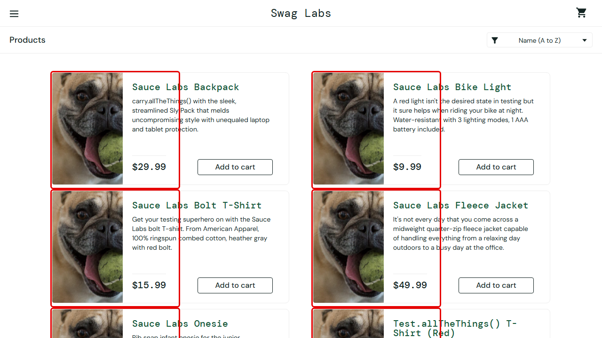

# BUG-08: tái hiện độc lập (2026-11-25)

**`problem_user`: cả 6 ảnh sản phẩm là ảnh lỗi**

Script riêng [`tests/repro/saucedemo-products-cart-screen.repro.ts`](../../../../../../tests/repro/saucedemo-products-cart-screen.repro.ts) (`npm run repro -- saucedemo-products-cart-screen`), **không** dùng code test: locator id / class CSS, mỗi tình huống một phiên trình duyệt mới (giỏ trống), Chromium 1280×720. Mỗi tình huống chạy 2 lần: **2/2 lần, kết quả giống nhau**. Ảnh của lần 2, khung đỏ do script vẽ để chỉ chỗ lỗi. Các bước làm bằng tay nằm trong `defects.md`.

| # | Thao tác | Kết quả thấy được | Ảnh |
|---|---|---|---|
| 1 | Đăng nhập `problem_user`, xem ảnh 6 sản phẩm | 6/6 ảnh là `sl-404` (ảnh lỗi) |  |

Kết luận: cả 6 ảnh là ảnh lỗi `sl-404` (`standard_user`: 0/6).
