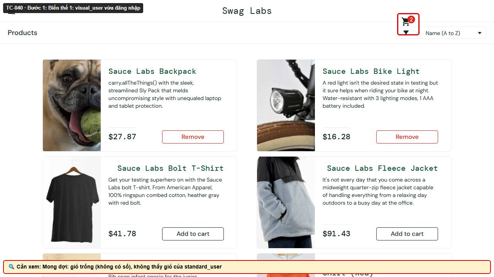
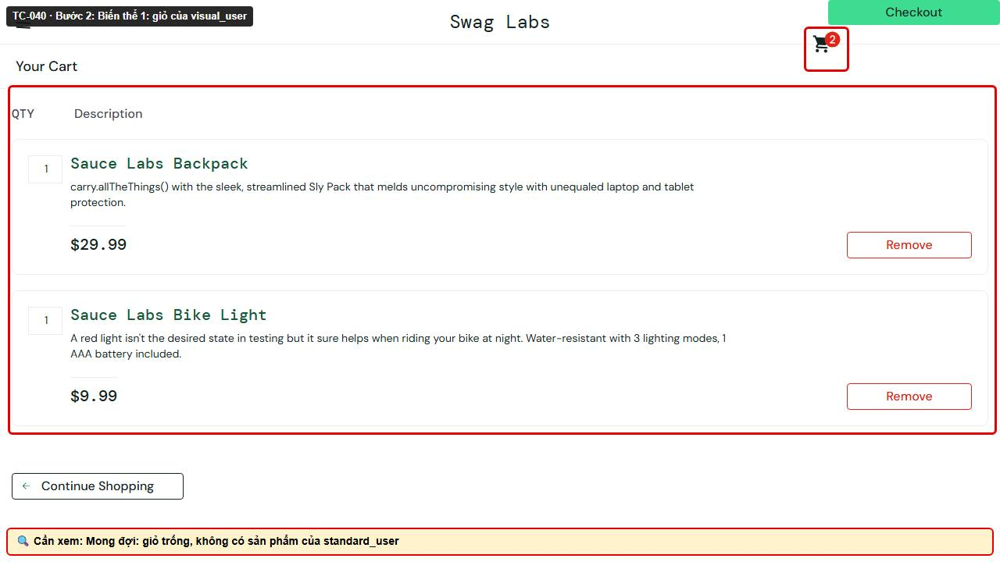
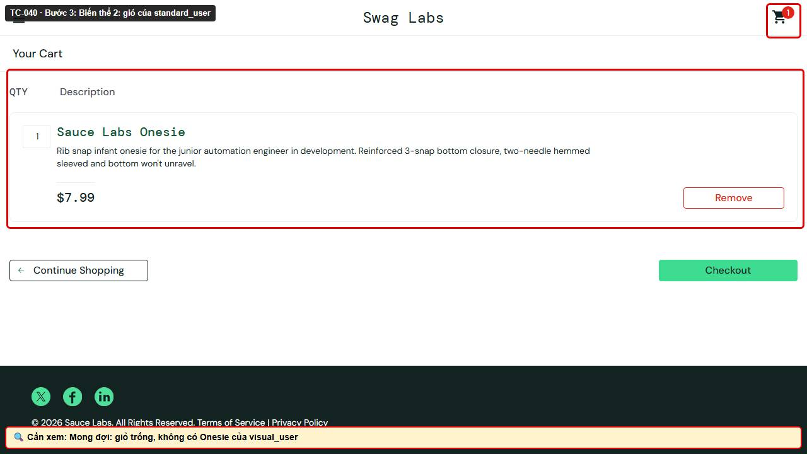
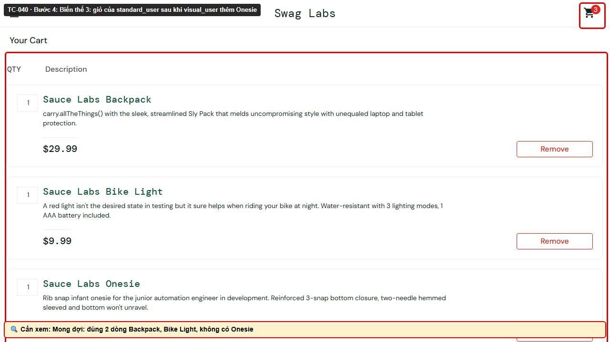

# TC-040 tài khoản khác không thấy và không sửa được giỏ của người trước

- **Kết quả**: ❌ Failed · Bug: BUG-07
- **Nhóm**: Chung: nhiều màn hình (tài khoản, giỏ, menu, kiểm soát truy cập)
- **Tags**: @AC-7 @list @cart @security @BUG-07
- **Thời điểm**: 2026-11-25T05:07:22.823Z
- **Video**: [video.webm](video.webm)

| Bước | Thao tác | Cần xem | Ảnh |
|---|---|---|---|
| 1 | Biến thể 1: visual_user vừa đăng nhập | Mong đợi: giỏ trống (không có số), không thấy giỏ của standard_user |  |
| 2 | Biến thể 1: giỏ của visual_user | Mong đợi: giỏ trống, không có sản phẩm của standard_user |  |
| 3 | Biến thể 2: giỏ của standard_user | Mong đợi: giỏ trống, không có Onesie của visual_user |  |
| 4 | Biến thể 3: giỏ của standard_user sau khi visual_user thêm Onesie | Mong đợi: đúng 2 dòng Backpack, Bike Light, không có Onesie |  |
