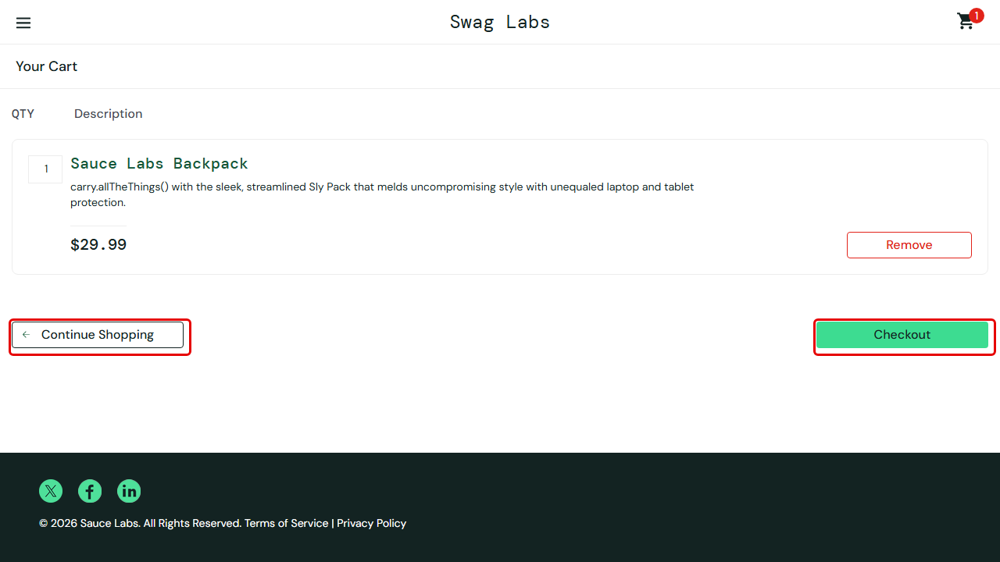
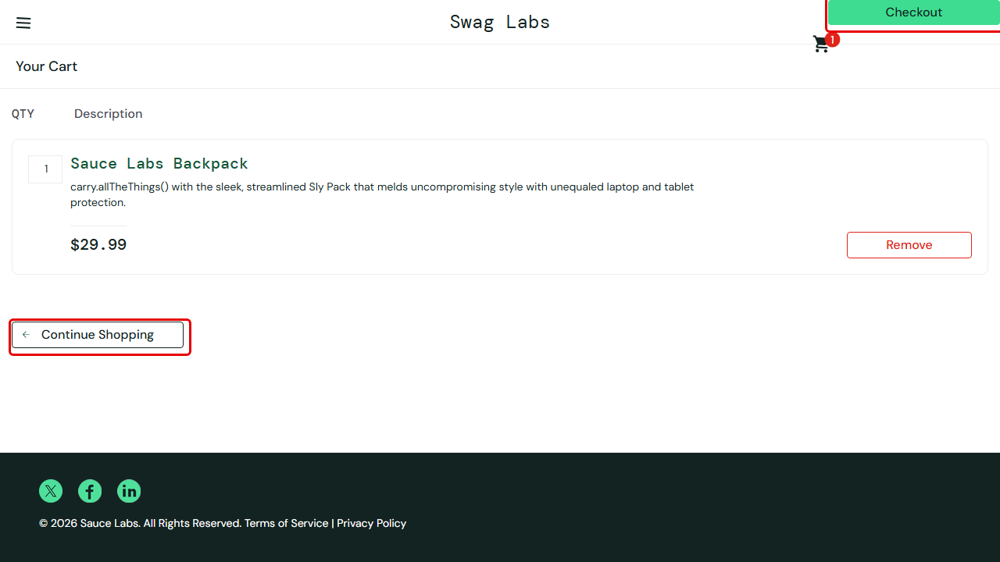

# BUG-18: tái hiện độc lập (2026-11-25)

**`visual_user`: nút Checkout bị đẩy lên vùng tiêu đề**

Script riêng [`tests/repro/saucedemo-products-cart.repro.ts`](../../../../../../tests/repro/saucedemo-products-cart.repro.ts) (`npm run repro -- saucedemo-products-cart`), **không** dùng code test: locator id / class CSS, mỗi tình huống một phiên trình duyệt mới (giỏ trống), Chromium 1280×720. Mỗi tình huống chạy 2 lần: **2/2 lần, kết quả giống nhau**. Ảnh của lần 2, khung đỏ do script vẽ để chỉ chỗ lỗi. Các bước làm bằng tay nằm trong `defects.md`.

| # | Thao tác | Kết quả thấy được | Ảnh |
|---|---|---|---|
| 1 | `standard_user`: giỏ có Backpack, đo nút Checkout và Continue Shopping (`getBoundingClientRect().y`) | Checkout y=412, Continue Shopping y=412 (lệch 0 px) |  |
| 2 | `visual_user`: giỏ có Backpack, đo nút Checkout và Continue Shopping (`getBoundingClientRect().y`) | Checkout y=0, Continue Shopping y=412 (lệch 412 px) |  |

Kết luận: ở `visual_user`, nút Checkout không cùng hàng với Continue Shopping mà nằm ở vùng tiêu đề phía trên.
