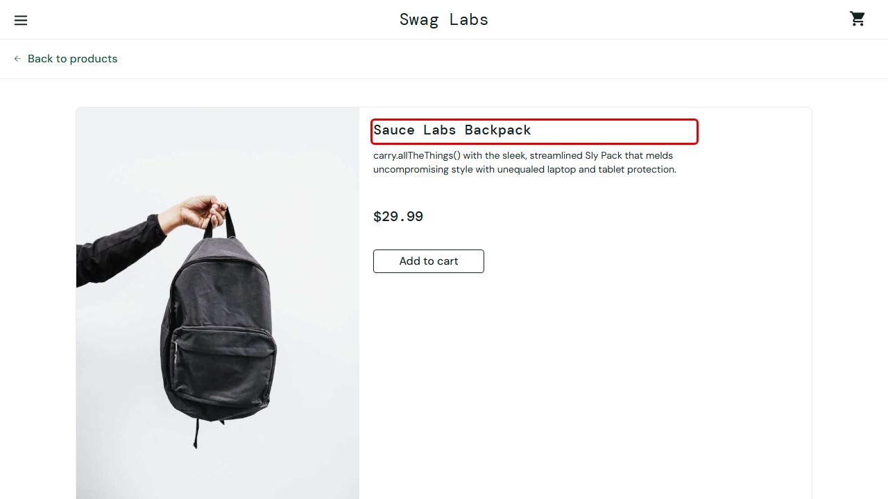
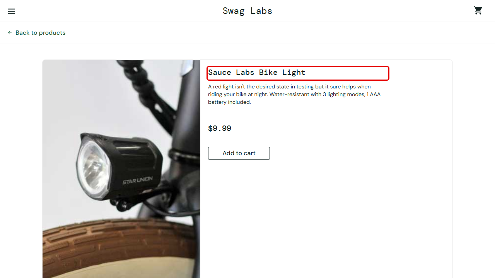

# BUG-20: tái hiện độc lập (2026-11-25)

**id sai định dạng vẫn mở sản phẩm**

Script riêng [`tests/repro/saucedemo-products-cart.repro.ts`](../../../../../../tests/repro/saucedemo-products-cart.repro.ts) (`npm run repro -- saucedemo-products-cart`), **không** dùng code test: locator id / class CSS, mỗi tình huống một phiên trình duyệt mới (giỏ trống), Chromium 1280×720. Mỗi tình huống chạy 2 lần: **2/2 lần, kết quả giống nhau**. Ảnh của lần 2, khung đỏ do script vẽ để chỉ chỗ lỗi. Các bước làm bằng tay nằm trong `defects.md`.

| # | Thao tác | Kết quả thấy được | Ảnh |
|---|---|---|---|
| 1 | Mở `/inventory-item.html?id=4abc` | Hiện sản phẩm `Sauce Labs Backpack` |  |
| 2 | Mở `/inventory-item.html?id=-0` | Hiện sản phẩm `Sauce Labs Bike Light` |  |
| 3 | Đối chứng: mở `?id=abc` | Hiện `ITEM NOT FOUND` (đúng) |  |

Kết luận: id sai định dạng được đọc như số (`4abc` → 4, `-0` → 0) nên mở sản phẩm thay vì báo không tìm thấy. Test tự động thử đủ 10 giá trị.
