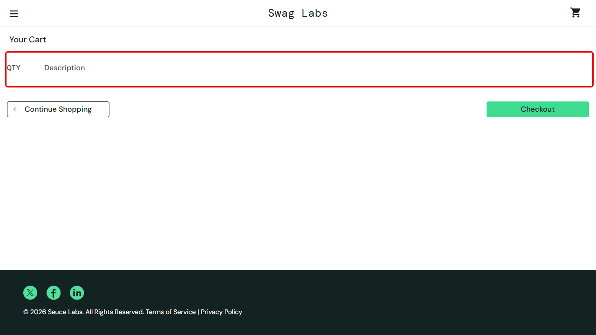
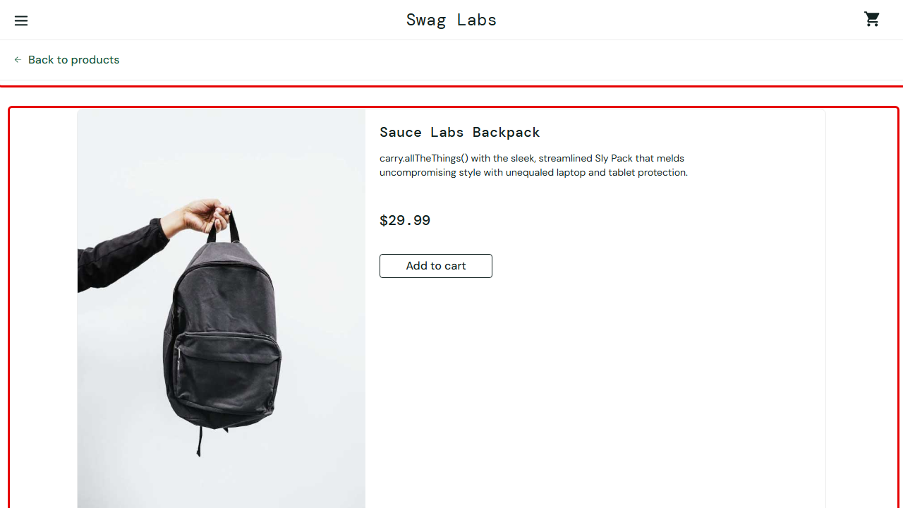

# BUG-02: tái hiện độc lập (2026-11-25)

**Biến thể SD-102: cookie tự tạo vào được trang giỏ và trang chi tiết**

Script riêng [`tests/repro/saucedemo-products-cart.repro.ts`](../../../../../../tests/repro/saucedemo-products-cart.repro.ts) (`npm run repro -- saucedemo-products-cart`), **không** dùng code test: locator id / class CSS, mỗi tình huống một phiên trình duyệt mới (giỏ trống), Chromium 1280×720. Mỗi tình huống chạy 2 lần: **2/2 lần, kết quả giống nhau**. Ảnh của lần 2, khung đỏ do script vẽ để chỉ chỗ lỗi. Các bước làm bằng tay nằm trong `defects.md`.

| # | Thao tác | Kết quả thấy được | Ảnh |
|---|---|---|---|
| 1 | Trang đăng nhập, Console: `document.cookie = "session-username=standard_user"`, mở `/cart.html` | Ở `/cart.html`, thấy nội dung, không có thông báo đăng nhập |  |
| 2 | Trang đăng nhập, Console: `document.cookie = "session-username=standard_user"`, mở `/inventory-item.html?id=4` | Ở `/inventory-item.html`, thấy nội dung, không có thông báo đăng nhập |  |

Kết luận: cookie tự tạo vào được cả `/cart.html` và `/inventory-item.html?id=4`, giống BUG-02 ở `/inventory.html` (SD-101).
