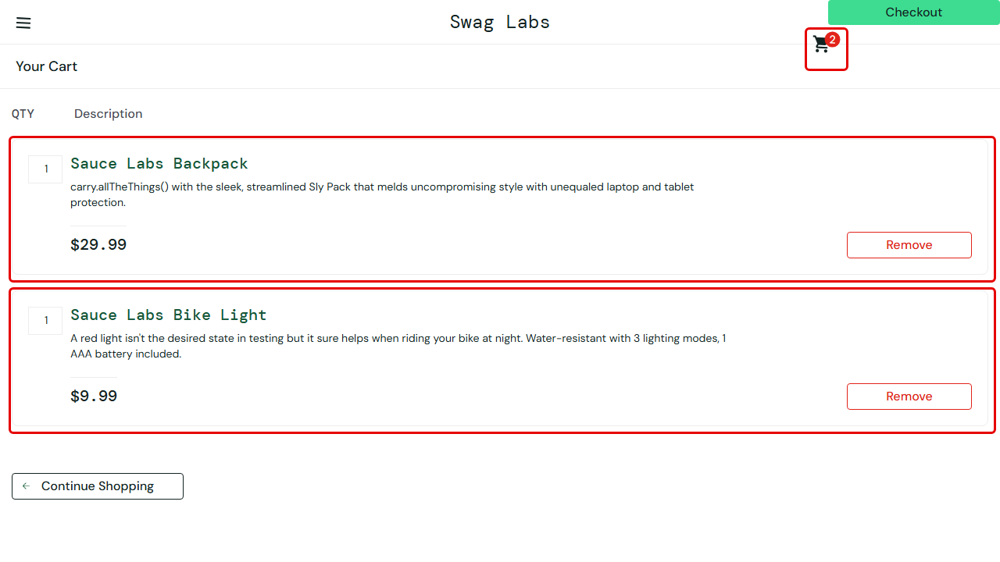
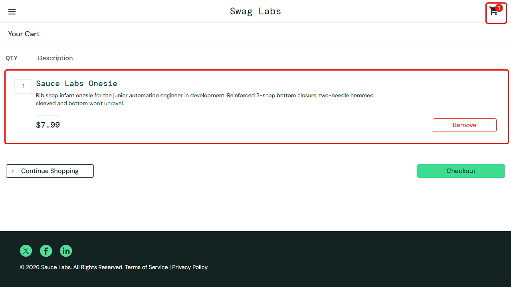
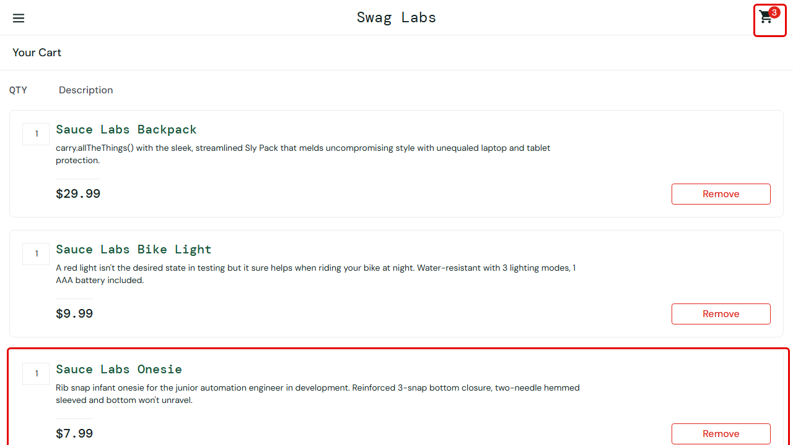
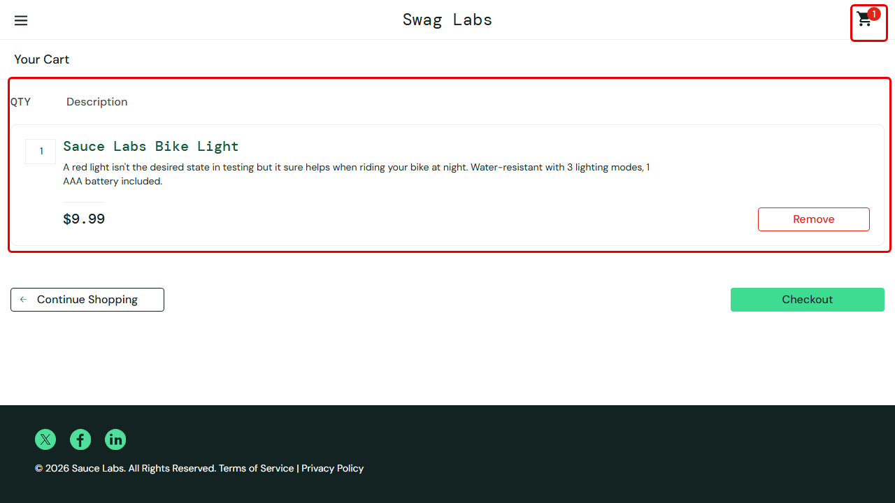

# BUG-07: tái hiện độc lập (2026-11-25)

**Giỏ không gắn với tài khoản: người sau thấy, sửa, xóa được giỏ người trước**

Script riêng [`tests/repro/saucedemo-products-cart.repro.ts`](../../../../../../tests/repro/saucedemo-products-cart.repro.ts) (`npm run repro -- saucedemo-products-cart`), **không** dùng code test: locator id / class CSS, mỗi tình huống một phiên trình duyệt mới (giỏ trống), Chromium 1280×720. Mỗi tình huống chạy 2 lần: **2/2 lần, kết quả giống nhau**. Ảnh của lần 2, khung đỏ do script vẽ để chỉ chỗ lỗi. Các bước làm bằng tay nằm trong `defects.md`.

| # | Thao tác | Kết quả thấy được | Ảnh |
|---|---|---|---|
| 1 | 1. Đọc: `standard_user` thêm Backpack, Bike Light, đăng xuất; `visual_user` đăng nhập, mở giỏ | Giỏ của `visual_user`: Sauce Labs Backpack, Sauce Labs Bike Light |  |
| 2 | 2. Đọc, chiều ngược: `visual_user` thêm Onesie, đăng xuất; `standard_user` đăng nhập, mở giỏ | Giỏ của `standard_user`: Sauce Labs Onesie |  |
| 3 | 3. Ghi: `standard_user` thêm Backpack, Bike Light; `visual_user` thêm Onesie; `standard_user` đăng nhập lại, mở giỏ | Giỏ của `standard_user`: Sauce Labs Backpack, Sauce Labs Bike Light, Sauce Labs Onesie (số giỏ 3) |  |
| 4 | 4. Xóa: `standard_user` thêm Backpack, Bike Light; `visual_user` bỏ Backpack; `standard_user` đăng nhập lại, mở giỏ | Giỏ của `standard_user`: Sauce Labs Bike Light (số giỏ 1) |  |

Kết luận: người đăng nhập sau thấy giỏ của người trước (cả 2 chiều), thêm được hàng vào và bỏ được hàng khỏi giỏ đó; người trước đăng nhập lại thấy giỏ đã bị đổi.
