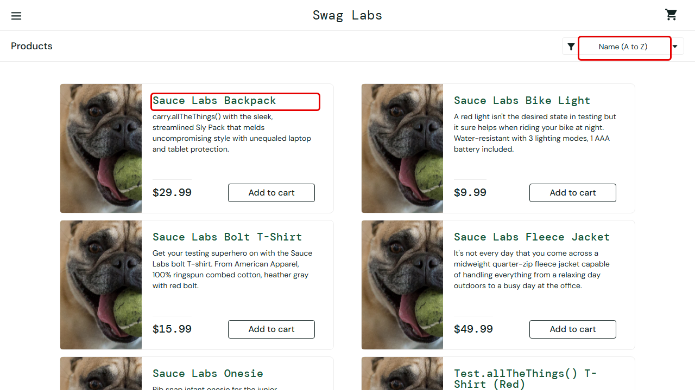

# BUG-09: tái hiện độc lập (2026-11-25)

**`problem_user`: sắp xếp không hoạt động**

Script riêng [`tests/repro/saucedemo-products-cart.repro.ts`](../../../../../../tests/repro/saucedemo-products-cart.repro.ts) (`npm run repro -- saucedemo-products-cart`), **không** dùng code test: locator id / class CSS, mỗi tình huống một phiên trình duyệt mới (giỏ trống), Chromium 1280×720. Mỗi tình huống chạy 2 lần: **2/2 lần, kết quả giống nhau**. Ảnh của lần 2, khung đỏ do script vẽ để chỉ chỗ lỗi. Các bước làm bằng tay nằm trong `defects.md`.

| # | Thao tác | Kết quả thấy được | Ảnh |
|---|---|---|---|
| 1 | Đăng nhập `problem_user`, chọn **Name (Z to A)** | Nhãn dropdown `Name (A to Z)`; đứng đầu `Sauce Labs Backpack`; không có thông báo |  |
| 2 | Đăng nhập `problem_user`, chọn **Price (low to high)** | Nhãn dropdown `Name (A to Z)`; đứng đầu `Sauce Labs Backpack`; không có thông báo |  |
| 3 | Đăng nhập `problem_user`, chọn **Price (high to low)** | Nhãn dropdown `Name (A to Z)`; đứng đầu `Sauce Labs Backpack`; không có thông báo |  |

Kết luận: cả 3 kiểu sắp xếp: nhãn vẫn `Name (A to Z)`, Sauce Labs Backpack vẫn đứng đầu, không có thông báo.
